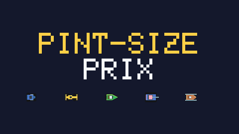

# Pint-Size Prix



A top-down miniature racing game written in C++17 with SDL2. Thumb-sized vehicles race across everyday places: a breakfast table, a woodworking bench, a freezer drawer, a sink full of dishes, an office desk and a backyard sandbox.

The game is built for the keyboard, including two players sharing one. All artwork and sound are generated in code when the game runs, so the repository contains no asset files.

## Contents

- [Features](#features)
- [Building](#building)
- [How to play](#how-to-play)
- [LAN play](#lan-play)
- [Project layout](#project-layout)
- [How it works](#how-it-works)
- [Tuning and extending](#tuning-and-extending)
- [Testing](#testing)
- [License](#license)

## Features

- Six courses, each a real-life environment with its own vehicle
- Solid obstacles at believable scale: plates, bottles, saws, books, saucepans, sandcastles
- Momentum-based handling: cars rotate directly and slide before they grip
- Table edges you can fall from, jumps across gaps, and spills that change your grip
- Tournament, head-to-head (against the CPU or a second player) and time trial modes
- LAN races for up to four machines, Windows and Linux mixed, with a headless computer driver (`psp_bot`) and a simulated poor connection for trying out lag and packet loss
- Computer drivers that plan their own line around whatever is on the course
- Synthesised engine, skid and impact sounds, plus a menu tune

## Building

### Requirements

- CMake 3.16 or newer
- A C++17 compiler
- SDL2, which can come from vcpkg or a system package, or be downloaded automatically by CMake
- ENet 1.3.18 for LAN play. CMake downloads and compiles it during the first configure, so that step needs an internet connection. It uses vcpkg's `enet` port instead if one is installed

The game is developed and tested on Windows. The Linux build (game, bot and tests) has been built and tested on Ubuntu 24.04 under WSL, including LAN races against a Windows machine. macOS has not been tested.

### Windows with Visual Studio 2022 and vcpkg

The `vcpkg.json` manifest installs SDL2 into the build folder, leaving your global vcpkg tree alone. This assumes `VCPKG_ROOT` points at your vcpkg checkout.

```powershell
cmake -S . -B build -G "Visual Studio 17 2022" -A x64 `
      -DCMAKE_TOOLCHAIN_FILE="$env:VCPKG_ROOT/scripts/buildsystems/vcpkg.cmake" `
      -DVCPKG_TARGET_TRIPLET=x64-windows
cmake --build build --config Release
.\build\Release\pintsize.exe
```

`SDL2.dll` is copied next to the executable. Keep the two together if you move the game.

### Without vcpkg

If CMake cannot find an installed SDL2, it downloads SDL 2.30.9 and links it statically:

```powershell
cmake -S . -B build -G "Visual Studio 17 2022" -A x64
cmake --build build --config Release
.\build\Release\pintsize.exe
```

Pass `-DPSP_FORCE_FETCH_SDL=ON` to use the downloaded copy even when SDL2 is installed.

### Linux and macOS

```sh
# Debian or Ubuntu
sudo apt install build-essential cmake libsdl2-dev
# macOS
brew install cmake sdl2

cmake -S . -B build
cmake --build build -j
./build/pintsize
```

On a machine that only runs the headless bot, `-DPSP_BUILD_GAME=OFF` skips the game and with it the need for SDL2:

```sh
cmake -S . -B build -DPSP_BUILD_GAME=OFF
cmake --build build -j
./build/psp_bot --help
```

## How to play

### Controls

|               | Player 1     | Player 2   |
|---------------|--------------|------------|
| Steer         | Left / Right | A / D      |
| Accelerate    | Up           | W          |
| Brake/reverse | Down         | S          |
| Fire (tanks)  | Right Shift  | Left Shift |

When you play alone, either set works, and X (accelerate), Z (brake) and Space or either Shift (fire) are also available.

| Key                 | Action                                    |
|---------------------|-------------------------------------------|
| Arrow keys          | Move through menus                        |
| Enter or Space      | Confirm                                   |
| Esc                 | Go back, or pause during a race           |
| M                   | Mute                                      |
| F11                 | Toggle fullscreen                         |
| F9                  | LAN play: cycle the simulated connection  |
| F10                 | LAN play: show network statistics         |

Steering is linear: the angle you turn is proportional to how long you hold the key, and it works even when the car is standing still. A car keeps its momentum after you turn, so expect to slide, especially on low-grip vehicles and surfaces.

### Game modes

**Tournament.** Race three computer cars through all six courses in order. Finish 1st or 2nd to advance. Any lower finish costs one of your three lives and you retry the course. Three wins in a row earn an extra life. The computer cars get better each round.

**Head to head.** Two cars share one screen, which follows whoever is ahead. Each player starts with 4 of the 8 points. Leave your rival behind the edge of the screen and you take a point from them, then both cars restart together at the leader's position. Collect all 8 to win outright. Otherwise, whoever has more points when the leader completes the course's laps wins, and a tie goes to sudden death, where the next point decides it. Play against the CPU or against a second player on the same keyboard.

**LAN race.** A circuit race against people or bots on other machines, with computer cars to fill the grid. See [LAN play](#lan-play).

**Time trial.** Drive alone on any course. Your best lap for each course is saved in SDL's preference folder for `PintSize/Prix` (on Windows, `%APPDATA%\PintSize\Prix\best.dat`).

### Courses

| Course          | Environment       | Vehicle | Laps | Watch out for                                  |
|-----------------|-------------------|---------|------|------------------------------------------------|
| Sunday Brunch   | Kitchen table     | Coupe   | 3    | The table edge, juice and jam spills, cutlery  |
| Sawdust Sprint  | Woodworking bench | Buggy   | 3    | The bench edge, a jump over the tool well, glue |
| Deep Freeze     | Freezer drawer    | Sled    | 3    | Very little grip, ice patches, deep frost      |
| Dishwater Dash  | Kitchen sink      | Skiff   | 3    | Floating dishes, suds, a drain that swallows you |
| Homework Hustle | Office desk       | Formula | 3    | The desk edge, two jumps, ink spills           |
| Backyard Blitz  | Sandbox           | Tank    | 2    | Loose sand beside the lane, enemy fire         |

There is no painted road. Each course marks its route with something that belongs there: a trail of spilled cereal, snapped chalk lines, rows of frozen peas, lines of soap bubbles, highlighter strips, or a packed-down lane edged with pebbles.

### Vehicles

| Vehicle | Accel | Top speed | Turn rate | Grip | Mass | Off-road penalty | Notes                 |
|---------|-------|-----------|-----------|------|------|------------------|-----------------------|
| Coupe   | 360   | 235       | 5.4       | 8.5  | 1.0  | 1.0              | Balanced              |
| Buggy   | 400   | 225       | 5.6       | 6.5  | 1.1  | 0.45             | Shrugs off rough ground |
| Formula | 460   | 290       | 5.2       | 11.0 | 0.85 | 1.3              | Fast and grippy, hates rough ground |
| Skiff   | 300   | 240       | 4.4       | 2.6  | 1.0  | 1.0              | Drifts like a boat    |
| Tank    | 290   | 190       | 3.8       | 16.0 | 2.2  | 0.2              | Heavy, armed, barely slides |
| Sled    | 320   | 230       | 5.0       | 3.6  | 0.9  | 1.0              | Slides through every corner |

Speeds are in pixels per second, acceleration in pixels per second squared, turn rate in radians per second and grip in sideways-velocity decay per second. The player's turn rate is 48% of the listed value (see [Tuning](#tuning-and-extending)).

### Surfaces and hazards

| Surface         | Examples                       | Effect                                             |
|-----------------|--------------------------------|----------------------------------------------------|
| Normal ground   | Tablecloth, wood, water        | Full performance, except in the freezer (75% grip) |
| Rough           | Sawdust, sandpaper, loose sand, suds | Less acceleration and grip, plus drag, scaled by the vehicle's off-road penalty |
| Slick           | Juice, milk, coffee, ink, ice  | 60% acceleration and almost no grip                |
| Sticky          | Jam, glue                      | About half acceleration and heavy drag             |
| Solid           | Plates, bottles, tools, walls  | You bounce off                                     |
| Drop            | Table edges, gaps, the drain   | You fall and are put back on the course            |

Other rules worth knowing:

- Cars bounce hard off each other, so a well-timed shove can send a rival into an obstacle or off the table.
- After a fall you reappear near the last safe spot, in a space clear of other cars and obstacles, and flicker for 1.6 seconds while shells cannot hit you. If you fell at a jump, you restart with a run-up.
- The ground beside the route is open, but going more than about 100 pixels past the route's edge puts you straight back on course.
- A ramp launches you as you leave it, so the faster you hit it the further you fly. Too slow and you land in the gap.
- A tank shell spins its target for 0.8 seconds, and the target is briefly protected from further hits.

## LAN play

Up to four machines can race each other on a local network, Windows and Linux mixed. Each player drives from their own machine and keyboard, and the host can fill the grid with computer cars. LAN races are circuit races over the course's usual number of laps. Head-to-head is not available over the network yet.

### Before you start

- **Same version everywhere.** Build every machine from the same commit. Machines with different versions refuse to race each other.
- **One player per machine.** The game reads the keyboard only in the focused window, so two game windows on one PC cannot both be driven. For two people, use two machines.
- **The game or the bot.** A machine with a player runs the game, `pintsize`, which needs SDL2 and a display. A machine that only supplies a computer opponent can run `psp_bot`, which needs neither. See [Building](#building), and `-DPSP_BUILD_GAME=OFF` for a bot-only build.
- **Network.** Everyone must be on the same network. A wired connection gives the smoothest race.
- **Firewall.** The host receives UDP on ports 47474 (the race) and 47475 (LAN search).
  - Windows asks the first time you host; choose **Allow**.
  - If your network is set to *Public*, allow public networks too, or switch the network to *Private*.
  - On Linux with ufw, run `sudo ufw allow 47474:47475/udp`.
- **The host's address.** You need it only if the search does not find the host.
  - On Windows, run `ipconfig` and read *IPv4 Address* under the adapter on your network.
  - On Linux, run `hostname -I`.

### Two players on two machines

1. **Host.** On one machine, choose **LAN RACE** from the main menu, then **HOST A RACE**. The lobby opens, showing the players who have joined.
2. **Join.** On the other machine, choose **LAN RACE**, then **JOIN A RACE**. Pick the host from the list and press Enter. If the list stays empty, start the game with the host's address instead:

   ```sh
   ./build/pintsize --join 192.168.1.20                  # Linux
   .\build\Release\pintsize.exe --join 192.168.1.20      # Windows
   ```

3. **Set up the race (host only).** In the lobby:
   - Left and Right choose the course.
   - Up and Down set how many computer cars join; use 0 for a one-on-one.
   - Enter starts the race.
4. **Race.** Everyone sees the countdown at the same moment. Steer with the usual keys; either set works, as when playing alone.
5. **After the race.** Everyone gets the same result screen. Enter goes back to the lobby, where the host can pick another course and start again. Esc leaves.

A player can join while a race is running. They wait in the lobby and take part in the next race.

Your name in the lobby is your computer's name. Your car uses the driver you last picked in Tournament or Time Trial. If someone has already taken that driver, you get the next free one.

### Playing against the bot

`psp_bot` is a computer driver that takes part like another machine. It has no window and prints the lobby, its lap times, the results and network statistics to its terminal.

- **Your game hosts.** Host from the game, then start the bot. It can run on the same PC or on any other machine on the network:

  ```sh
  psp_bot --join 127.0.0.1         # on the same PC
  psp_bot --join 192.168.1.20      # from another machine, by the host's address
  psp_bot --join                   # search the network and join the first host found
  ```

  The bot is `./build/psp_bot` on Linux and `.\build\Release\psp_bot.exe` on Windows. It waits in your lobby until you press Enter.

- **The bot hosts.** Start the bot first, then join from the game:

  ```sh
  psp_bot --host --players 2 --cpu 2
  ```

  It starts a race 3 seconds after you join, and another about 7 seconds after each race ends, until you leave.

| Bot option             | Meaning                                                                 |
|------------------------|-------------------------------------------------------------------------|
| `--join [ADDRESS[:PORT]]` | Join a host. With no address, search the network                    |
| `--host`               | Host races                                                              |
| `--players N`          | Host: start once N machines, the bot included, are in (default 2)       |
| `--cpu N`              | Host: computer cars to add (default 0)                                  |
| `--track N` or `cycle` | Host: course 0 to 5, or each course in turn (default 0)                 |
| `--laps N`             | Host: laps per race (default: the course's own number)                  |
| `--races N`            | Host: stop after N races                                                |
| `--bind ADDRESS`       | Host: listen on one interface only, such as `127.0.0.1`                 |
| `--skill X`            | Driving speed, 0.5 to 1.1 (default 1.0)                                 |
| `--name NAME`, `--color 0..5` | Name in the lobby and preferred driver                           |
| `--lag`, `--jitter`, `--loss` | Simulate a poor connection, as below                             |
| `--stats SECONDS`, `--quiet` | How often to print network statistics (0 for never), or print only connections and results |

### During a LAN race

| Key                  | Action                                                                                  |
|----------------------|-----------------------------------------------------------------------------------------|
| Driving keys         | As usual; either set works                                                              |
| Esc                  | Opens a menu: **BACK TO THE RACE** or **LEAVE THE RACE**. The race does not pause, and your car lets go of the controls while the menu is open |
| F9                   | Cycle the simulated connection (see below)                                              |
| F10                  | Show network statistics                                                                 |

If a player leaves mid-race, the host's computer takes over their car and finishes the race with it. If the host leaves, the race ends for everyone with **THE HOST LEFT**.

### Simulating a poor connection

To feel how the game copes with a bad network, any machine can add delay and packet loss to its own traffic, in both directions. Setting it on one machine is enough.

In the game, press **F9** to step through these presets, on any screen:

| Preset | Delay each way | Jitter | Loss |
|--------|----------------|--------|------|
| 1      | none           | none   | none |
| 2      | 20 ms          | ±5 ms  | 1%   |
| 3      | 50 ms          | ±15 ms | 3%   |
| 4      | 100 ms         | ±30 ms | 5%   |
| 5      | 200 ms         | ±60 ms | 10%  |

The active setting is shown in red in the lobby and during the race. You can also choose exact values on the command line, for the game or the bot:

```sh
pintsize --join 192.168.1.20 --lag 80 --jitter 30 --loss 5
psp_bot --host --lag 100 --jitter 40 --loss 10
```

- **`--lag`** is the delay added each way, in milliseconds.
- **`--jitter`** varies that delay at random by up to this much either side. Packets keep their order, as in a real network queue, so a delayed packet holds up the ones behind it and they arrive bunched together.
- **`--loss`** is the chance, in percent, that each packet is lost. A lost car state simply vanishes. Other messages, such as bumps and results, arrive late instead, as after a resend.

**F10** shows what the connection is doing:

| Line           | Meaning                                                                                |
|----------------|----------------------------------------------------------------------------------------|
| ROUND TRIP     | Time for a message to reach the host and come back. On the host, the slowest client's  |
| CLOCK WITHIN   | How far this machine's copy of the shared race clock can be off. Always 0 on the host  |
| STATES / LOST  | Car states received and lost per second. Each other machine sends 60 a second          |
| AGE            | How old car states are when they arrive                                                |

### Game command-line options

| Option                    | Meaning                                               |
|---------------------------|-------------------------------------------------------|
| `--host`                  | Open a hosted lobby straight away                     |
| `--join ADDRESS[:PORT]`   | Join that host straight away. The port defaults to 47474 |
| `--lag MS`, `--jitter MS`, `--loss PERCENT` | Start with a simulated poor connection |

### Troubleshooting

| Problem | What to do |
|---------|------------|
| **JOIN A RACE** finds nothing | Check the host's firewall and network profile, as above. Search does not cross routers, VPNs or virtual machine networks, and extra network adapters (VirtualBox, Hyper-V, WSL, ZeroTier) can carry the search away from your LAN. Join by address with `--join`. |
| COULD NOT REACH THE HOST | Check the address, that the host is in its lobby, and that its firewall lets UDP 47474 in. |
| DIFFERENT GAME VERSIONS, or THIS COURSE DIFFERS FROM THE HOST'S | Build every machine from the same commit. |
| THE RACE IS FULL | A race takes four machines at most. |
| TOOK TOO LONG TO START | A machine needed more than 15 seconds to prepare the course, and the race started without it. |
| The other cars jump around | Press F10. A high LOST rate or AGE means a poor connection; try a cable instead of Wi-Fi. Check that F9 is not simulating lag. |
| Racing against WSL on the same PC | WSL is behind its own network address translation, so search does not reach it. From Windows, join the address shown by `ip -4 addr show eth0` in WSL. From WSL, join the Windows address shown by `ip route` (after `via`). |

### How LAN play works

Every machine runs its own *race module*: a `Race` that drives the cars belonging to that machine and shows everyone else's from what they send. Single player is one module that drives every car.

- **Sharing news.** After each step, a module sends its `RaceNews`. That is the states of its cars, about 90 bytes each, plus anything that must not be lost: bumps, shells fired and hit, sound events and the host's results. Car states go unreliably at 60 Hz and the rest reliably. Clients connect only to the host, which passes news between them.
- **Showing other cars.** A car from another machine is moved on from its last state by its velocity and turn rate until the next state arrives. A lost packet costs only a little extrapolation.
- **One clock.** Clients synchronise with the host's clock using pings, keeping the reply with the shortest round trip. Every machine makes step N at the same moment, the shared start time plus N ticks, so a state from step N can be moved on to any other step exactly.
- **Collisions.** Cars in the same module are solved together, as in single player. For a car from another module, the module works out the contact on a scratch copy and moves only its own car. The other module does the same with its car. A bounce is also sent as a contact message, so neither side misses its half when the two see the bump a tick apart.
- **Shells.** Each module decides whether a shell hits its own cars, whoever fired it, and announces hits so the shell disappears everywhere.
- **Results.** The host referees. It places finishers by their own finishing times, ends the race and sends the result.

`LocalLink` (`src/link.h`) connects modules inside one process with direct calls, optionally with delay and lost states. The tests use it to run whole races across a simulated network.

## Project layout

```
CMakeLists.txt     Build definition
vcpkg.json         vcpkg manifest (SDL2)
src/
  common.h         Vec2, angle helpers, the Surface enum, view size and tick rate
  pix.h            Colour, noise and signed-distance helpers for the procedural art
  props.h          PROP_LIST: every object and its size, shadow height and solidity
  props.cpp        Per-pixel painters for every object
  tracks.cpp       Vehicle stats, environment settings and the six course layouts
  track.h/.cpp     Builds a course: route, ground, object placement, racing line
  race.h/.cpp      Game rules and physics: cars, collisions, laps, computer drivers, race modules
  link.h/.cpp      LocalLink: joins race modules in one process, with optional delay and loss
  net.h/.cpp       LAN play over ENet: sessions, lobby, clock sync, relaying, LAN search, simulated lag
  bot.cpp          psp_bot, the headless computer driver for LAN races
  gfx.h/.cpp       Rendering: world chunks, car sprites, particles, bitmap font
  audio.h/.cpp     Software synthesiser for engines, effects and the menu tune
  game.h/.cpp      Menus, screen flow, HUD, keyboard input, saved best laps
  main.cpp         Window, fixed-timestep loop and the --shot debug tool
tests/
  simtest.cpp      Headless test of every course and game mode
  nettest.cpp      LAN sessions over real loopback sockets, in one process
```

The code is split into layers. `psp_core` (`track`, `tracks`, `props`, `race`, `link`) contains the rules and world generation and has no SDL dependency, which is what lets the test program run without a display. `psp_net` adds LAN play on top of it, still without SDL, so `psp_bot` can run on a machine with no display. The `pintsize` executable adds rendering, sound and input.

## How it works

**Game loop.** The simulation advances in fixed 1/60-second ticks through `Race::step`, independently of the display's frame rate. Each frame is drawn to a 480×270 texture and scaled up to fit the window, which keeps the chunky pixel look at any size.

**Handling.** Each tick, a car's velocity is split into forward and sideways parts. Throttle and drag act on the forward part, and grip decays the sideways part, so a car that turns keeps sliding in its old direction until the grip catches up. Surfaces scale acceleration, grip and drag.

**Collisions.** Each car is a box matched to its sprite. Cars are tested against each other with the separating-axis test and pushed apart over several passes per tick, so a push can ripple through a pile of cars, and a car pinned against an object stays put while the other one moves. Objects are tested with probe points around the car's outline, using the surface map to find the true direction out of whatever was hit. A hit bounces both cars, briefly breaks the tyres' grip so the bounce carries them away, and adds spin if it lands off-centre.

**Building a course.** Each course is generated when it loads, in a few stages:

1. Control points are turned into a closed Catmull-Rom spline and resampled every 4 pixels.
2. A distance field records how far each pixel is from the route and which route sample is closest.
3. The base material is painted, along with route markings, ramps and gaps.
4. Objects are laid out, either at fixed positions, relative to the route, or scattered at random with a per-course seed. Scattered clutter is kept clear of the route.
5. Each object paints its shadow and itself, and writes to a surface map that gives every pixel its physical behaviour.
6. A racing line is planned over the finished surface map.

World scale is about 6 pixels per centimetre, so a dinner plate is around 170 pixels across and a car around 20.

**Object art.** Every object is a small analytic painter in `props.cpp`, evaluated per pixel in the object's own coordinates. Signed-distance shapes give the outlines, and simple sphere and cylinder lighting gives the shading, with the light direction rotated to match each object so that shadows and highlights stay consistent across the world.

**Computer drivers.** The racing line starts from an ideal that cuts the inside of bends, then a dynamic-programming search picks the cheapest path across the route's width. Paths near solid objects or drops are effectively forbidden, and rough or slippery ground costs extra, so the line adapts to any layout automatically. Computer cars then drive this line using the same steer, throttle and brake inputs a player has, with a speed profile that brakes ahead of tight sections. In races against a human, their speed is scaled between 90% and 110% depending on the gap, and it is never reduced on the approach to a jump.

**Graphics.** The world is uploaded as a grid of 256×256 textures, and only those in view are drawn. Each vehicle and driver colour gets a pre-rendered sheet of 64 rotation frames.

**Sound.** An SDL audio callback mixes two engine oscillators, a skid noise channel, sixteen one-shot effect voices and a short step-sequenced menu tune.

## Tuning and extending

| What you want to change                 | Where                                                     |
|-----------------------------------------|-----------------------------------------------------------|
| Vehicle speed, grip, weight, hit box    | `vehicleSpec` in `src/tracks.cpp`                         |
| How fast the player's car turns         | `PLAYER_TURN_SCALE` at the top of `src/race.cpp`          |
| Jump arc, bounciness, respawn timing    | Constants at the top of `src/race.cpp`                    |
| Surface effects                         | `surfaceFx` in `src/race.cpp`                             |
| Course layouts and object placement     | `buildTracks` in `src/tracks.cpp`                         |
| Amount and mix of clutter               | `themeDressing` in `src/tracks.cpp`                       |
| Tournament difficulty                   | `Game::startRace` in `src/game.cpp`                       |
| Key bindings                            | `Game::readPlayer` in `src/game.cpp`                      |

### Adding a course

Add a `TrackDef` in `buildTracks`:

- `points` are the route's control points in world pixels. The world is sized around them automatically.
- `jumps` take a route position in control-point units (3.5 is halfway between points 3 and 4) and a gap length. Put them on straight sections with room to build speed.
- `props` use three helpers: `P` places an object at a fixed position, `R` places it relative to the route by position and sideways offset, and `Under` places it beneath the water with no collision.

Then check the result. The test program reports any object blocking the racing line, and this renders the whole world to a bitmap:

```powershell
.\build\Release\pintsize.exe --shot world.bmp map:0
```

The saved best-lap table has room for 16 courses.

### Adding an object

Add a line to `PROP_LIST` in `src/props.h`, within the section for its environment, and add a matching `case` to that environment's painter in `src/props.cpp`. Section order matters, because `shadeProp` uses each object's position in the list to choose a painter. Keep `reach` large enough to cover everything the painter draws, or the object will be clipped.

## Testing

The headless tests need no display or sound device. `ctest` runs both: `simtest` takes a few seconds, and `nettest` races in real time for about 30 seconds.

```powershell
cd build
ctest -C Release --output-on-failure
```

Run `build\Release\psp_simtest.exe` directly to see the full report. For every course it checks that:

- no starting grid position is inside an object, and the racing line is clear
- computer cars finish at two skill levels
- a bot using the player's steering finishes
- cars never visibly overlap during a race, and staged crashes against cars and objects bounce apart
- head-to-head matches terminate and award points correctly
- a player who never moves loses every point in head-to-head and finishes last in a race

It also confirms that the angle turned is exactly proportional to how long the key is held. For LAN play, it splits races between two modules joined by a `LocalLink`. It runs them with one tick of delay, and with three ticks plus 10% of states lost, then checks that:

- both modules agree on the result
- each shows the other's cars within a few pixels of where they really are
- cars do not sink into each other, and a rear-end crash between modules bounces as hard as one inside a module

`psp_nettest` runs a host and two clients in one process over real sockets on 127.0.0.1, racing one lap in real time (about 30 seconds). One client simulates 50 ms ±25 of lag and 10% loss, then leaves partway, and the host must take over its car. The test checks that the race finishes, that host and the remaining client agree on the result, and how far each shows the others' cars from where they are.

To look at the game without playing it, `--shot` renders one frame off-screen:

```powershell
.\build\Release\pintsize.exe --shot frame.bmp race:0 600
```

The target can be `menu`, `race:N`, `h2h:N` or `map:N`, where `N` is a course number from 0 to 5. The optional last argument is how many ticks to simulate first. In race and head-to-head shots, computer drivers control every car.

## License

Released under the GNU General Public License v3.0. See [LICENSE](LICENSE).

SDL2 is a separate project under the zlib license.
